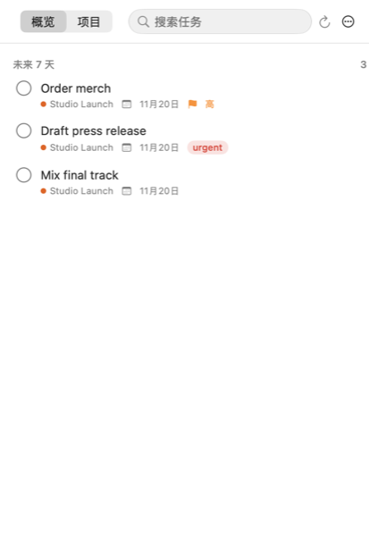
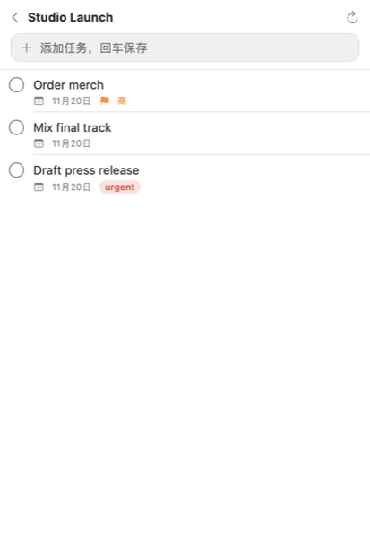
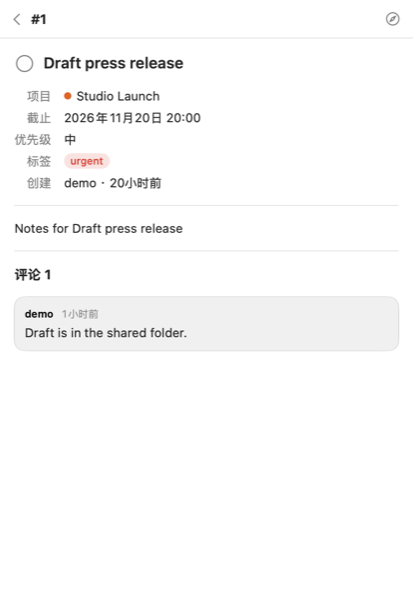

# Vikunja Bar

macOS menu bar app for browsing a [Vikunja](https://vikunja.io) server: open tasks grouped by due date, the project tree and saved filters, each project's tasks, and a task's details and comments. You can tick tasks done and add tasks to a project; anything more opens the task in the web app.

<p>



</p>

## Install

```sh
make install   # builds dist/VikunjaBar.app, copies it to /Applications, launches it
```

Requires macOS 26+ and a Swift 6.2 toolchain.

## Connect

Enter the server URL (the web app's address; a trailing `/api/v1` or `/api/v2` is fine) and an API token. Create the token in the web app under **Settings → API tokens** with at least:

| Group | Permissions |
| --- | --- |
| `projects` | `read_all`, `read_one` |
| `projects_views` | `read_all` |
| `projects_views_tasks` | `read_all` |
| `tasks` | `read_all`, `read_one`, `update`, `create` |
| `tasks_comments` | `read_all` |
| `other` | `user` |

The token is checked against `/api/v2/user` before it is saved to the login keychain (`com.nimrc.vikunja-bar`). **⋯ → 断开账号** removes it.

## What it shows

- **概览**: every open task, grouped into overdue, today, the next 7 days, later and undated. The menu bar icon shows the number overdue or due today.
- **项目**: projects in tree order (archived ones hidden) with their open-task counts, then saved filters. A project lists its tasks through its first List view, so that view's filter and sort apply.
- **Search**: the search field queries every project.
- **Task**: dates, priority, labels, assignees, the description and comments (fetched as Markdown), and a button that opens the task in the browser.

Data refreshes every 5 minutes and when the panel opens if it is more than a minute old.

## Development

```sh
make build && make test
```

`VikunjaCore` holds the API client (Vikunja `/api/v2`), models, keychain storage and grouping logic; `VikunjaBar` is the SwiftUI app.

Task changes use `PATCH`: v2's `PUT /tasks/{id}` replaces every field.

### Screenshots

```sh
VIKUNJA_URL=http://127.0.0.1:3456 VIKUNJA_TOKEN=tk_… \
  .build/debug/VikunjaBar --snapshot out.png --route task:1
```

Shows the panel in a window and captures it with `screencapture` (Liquid Glass does not render off screen). Routes: `overview`, `projects`, `project:<id>`, `task:<id>`, `search:<text>`, `settings`. Without the environment variables it uses the saved login. The terminal needs Screen Recording permission.
